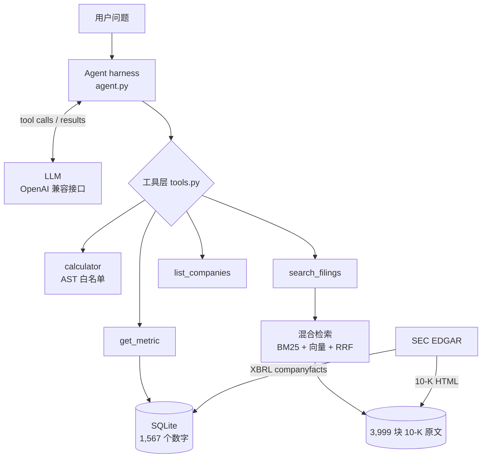

# fin-agent：一个读美股财报的问答 Agent

这是我做的一个 AI Agent，可以回答美股上市公司的财务问题。比如问它"Costco FY2025 营收增长了多少，管理层怎么解释"，它会自己去查数据库拿营收，用计算器算增长率，再去财报原文里找管理层的解释，最后给出答案，并且写清楚每个数字、每句话是从哪来的。

我没有用 LangChain 这类框架，Agent 的循环（harness）是我自己写的，大概 200 行。数据来自 SEC EDGAR，一共 20 家公司、FY2020 到 FY2025。我还自己出了 60 道题来评测它，3 次运行平均答对 99.4%。


上面是网页版的录屏（29 秒，没有加速）。左边是 Agent 每一步做了什么，右边是答案。答案里带红色 ✓ 的数字，都是从左边对应编号的那一步拿到的；下面带下划线的编号可以点开，看引用的原文。这里还有一张[静态截图](docs/screenshot.png)。

---

## 它是怎么工作的

我用 Costco 这道题举个例子。Agent 实际是这样做的：

```
[step 1] get_metric(COST, Revenue, 2025)        → 275.235B USD
[step 2] get_metric(COST, Revenue, 2024)        → 254.453B USD
[step 3] calculator((275.235-254.453)/254.453*100) → 8.17
[step 4] search_filings("why revenue increased ...", ticker=COST, fiscal_year=2025)
         → COST_2025_7_005 (Item 7 MD&A) ...
```

然后它回答：营收增长了 8.17%，管理层说主要是因为可比销售增长（购物频次 +5%，客单价约 +1%），还有 24 家新开的仓库；汽油降价和汇率拖了后腿。

这道题有意思的地方是它需要两种数据。增长率是数字，要从数据库查再计算；原因是一段文字，要去财报原文里找。我没有告诉它该怎么拆，它自己判断的。

整体结构是这样的：



Harness 其实就是一个循环。我把对话历史发给模型，如果模型说要用工具，我就执行这个工具，把结果加回历史，再问一次。如果模型不再要工具了，它说的话就是最终答案。我限制最多 8 步。走满 8 步还没结束的话，我就不再给它工具，让它用已经查到的信息直接回答。

模型能用的工具有 4 个：get_metric 查一个财务数字，calculator 做计算，search_filings 在财报原文里检索，list_companies 列出有哪些公司和指标。

---

## 我为什么这样设计

我一开始就决定不用 LangChain。这个项目只有一个 Agent、4 个工具，规模很小，框架帮不上太多忙。自己写的话，每一行我都能讲清楚，出了问题也知道去哪里找。代价是重试、流式输出这些功能都得自己写。

数据库我用的是"长表"，也就是一行只存一家公司、一个指标、一年的一个数字。这样 get_metric 的查询可以完全用 `?` 参数填空，不用把指标名拼进 SQL 里，就不会有 SQL injection 的问题。而且每个数字都能带上自己的出处（哪份 10-K）。代价是如果想一次看一家公司的所有指标，就要先转置（pivot）一下。

判断一个数字属于哪个财年，我用的是它的结束日期 `end`，没有用 XBRL 里的 `fy` 字段。因为我发现 `fy` 其实是"这份报告"的年份。一份 10-K 会同时列出最近三年的数字，它们的 `fy` 都一样。比如 Apple FY2024 的年报里，2022、2023、2024 三年的营收都标着 `fy=2024`。如果按 `fy` 取，就可能把 394.328B（2022 年）当成 2024 年的营收，算出来的增长率是 -0.84%，正确答案是 +2.02%，方向都反了。

同一个"营收"，不同公司用的标签名不一样，所以我给每个指标准备了一个候选名单，按顺序试。一开始我把 `RevenueFromContract...` 排在第一，后来拿真实数据一查，Walmart 用这个标签会少算会员费，648.125B 变成 642.637B，差了 0.85%。所以我把 `Revenues` 移到了第一。这个顺序不是想出来的，是用数据验证出来的。

有些公司就是不报某个数，比如 Walmart 没有单独报毛利。我没有自己算好再存进去，而是让它空着。这样数据库里的每个数字都有原始出处。需要毛利的时候，Agent 会自己用"营收 − 成本"算，并且在答案里说明这是推导出来的。代价是 Agent 要多走几步。

calculator 我没有用 Python 自带的 `eval()`，因为 `eval` 什么代码都能执行，比如 `eval("__import__('os').system('rm -rf ~')")` 会删掉文件。我是先把表达式解析成语法树（AST），只允许数字和 `+ - * / **` 通过。

工具出错的时候，我不让它直接报错崩掉，而是返回一句提示，比如"没有 Sales 这个指标，合法的有……Revenue……"。这句提示会发回给模型，模型看到后可以自己改过来。

数据库的安全我做了三层：白名单检查参数、`?` 参数化查询、只读模式打开数据库。任何一层单独都可能有漏洞，三层同时失效的可能性就小很多了。

检索我用了两种方法再合起来。BM25 是按关键词匹配，对"TSMC""Taiwan"这种专有名词很准，但不懂近义词；向量检索懂意思，"outsourced"和"outsourcing partners"它知道是一回事，但对专有名词没那么敏感。两种结果我用 RRF 合并，它只看名次，公式是 1/(60 + 名次)，所以不用管两种方法的分数尺度不一样。我没有用向量数据库，因为一共只有 3,999 个向量，而且会先按公司和年份筛选，NumPy 几毫秒就算完了。数据量到几十万的时候再换也不迟。

最后一个是财年 guardrail，这个是评测逼出来的，后面会讲。

---

## 我是怎么评测的

我出了 60 道题，放在 `evals/questions.jsonl`（40 道）和 `evals/hard.jsonl`（20 道难题）里。题目分成这几类：

| 类型 | 题数 | 考什么 |
|---|---|---|
| lookup | 15 | 查对一个数字 |
| calc | 15 | 查几个数字再计算，比如增长率、利润率、CAGR、推导缺失的毛利 |
| text | 10 | 在 10-K 原文里找到并总结 |
| hard_num | 10 | 不说年份（"最近一个财年"）、非日历财年、要查 10 次的题、数字只在原文里 |
| hard_text | 5 | 换一种说法问，问题里没有原文的关键词 |
| unanswerable | 5 | 数据里根本没有，正确做法是说"没有" |

数字题的标准答案我没有手填，而是写成表达式，直接从数据库算。比如 Apple 营收增长那道题，标准答案写的是 `(M('AAPL','Revenue',2024)/M('AAPL','Revenue',2023)-1)*100`。评分的时候，我从答案里把带单位的数字都找出来（B、亿、million、%、个百分点都认），只要有一个和标准答案的误差小于 1%，就算对。

原文题我从三个角度看。第一，检索结果里有没有包含关键句的那一段，这个我事先在原文里确认过。第二，答案里引用的段落编号，是不是真的在检索结果里，这是为了查它有没有编造出处。第三，让一个更强的模型（gpt-5.4）对照要点打 1 到 5 分，4 分以上算对。

不可回答的题，我让裁判模型判断 Agent 有没有明确说"数据不可用"，而不是拿别的数据凑一个答案。

结果是这样的（Agent 用 gpt-5.4-mini，每个配置跑 3 次取平均）：

| 类型 | 正确率 |
|---|---|
| lookup、calc、text、hard_num、unanswerable | 100% |
| hard_text | 93.3% |
| 总计（60 题 × 3 次） | 99.4%（179 / 180） |

原文题的检索命中率是 97.8%，编造引用 0 次。

### calculator 到底有没有用

我想知道 calculator 是不是真的有必要，就把它拿掉重跑了一遍。第一次的结果是计算题从 100% 掉到 65.3%，看起来 calculator 非常重要。

但我一道一道看失败的答案，发现大部分不是算错了，而是模型拒绝算。因为 system prompt 里还写着"必须用 calculator，不准心算"，工具没了规则还在，它就卡住了，反复查数据，最后放弃。所以这次实验其实测的是"规则和工具矛盾的时候会怎样"，不是"calculator 有没有用"。

然后我做了一个公平的版本：拿掉 calculator 的同时，把规则改成"自己仔细算"。

| 配置 | 计算类题目（25 题） | 平均步数 |
|---|---|---|
| 完整系统 | 100% | 2.61 |
| 去掉 calculator，但还保留"必须用 calculator"的规则 | 65.3% | 3.99 |
| 去掉 calculator，规则改成"自己算"（公平对比） | 97.3% | 2.21 |

真正的差距只有 2.7 个百分点，而且全部集中在一道题上：Alphabet 营收的 CAGR，要开 4 次方根。正确答案是 (350.018 / 182.527)^(1/4) − 1 = 17.68%，模型心算出来是 18.10%。所以我的结论是，对这个模型来说，加减乘除不用 calculator 也能算对，calculator 的价值在复杂运算和结果稳定。小模型的情况我还没测。

### 三种检索方式比一比

我在完整评测里比较 BM25、向量、混合三种检索，结果差不多（95.6% 到 97.8%），相差就是 45 次里错了 1 次，分不出是真差距还是运气。

我想原因是 Agent 每次都先按公司和年份筛选，剩下 40 块左右，哪种方法都容易找到。所以我把 Agent 在评测里实际写过的 43 条查询拿出来，在更严格的条件下重放（`evals/retrieval_ablation.py`）。这个测试不经过模型，结果每次都一样：

| 条件 | k | BM25 | 向量 | 混合 |
|---|---|---|---|---|
| 按公司 + 年份筛选（实际用法） | 1 | 70% | 63% | 72% |
| | 3 | 88% | 93% | 91% |
| | 5 | 98% | 95% | 98% |
| 不筛选（3,999 块里找） | 1 | 58% | 56% | 63% |
| | 3 | 72% | 72% | 79% |
| | 5 | 72% | 84% | 84% |

表里的 hit@k 是指前 k 个结果里，至少有一块包含关键句的比例。

我从这张表看出两件事。第一，筛选的作用最大，同样是混合检索取前 3 个，筛选后 91%，不筛选只有 79%。第二，条件越严格，混合检索的优势越明显，不筛选的时候它比两种单一方法都高 7 个百分点。

### 评测帮我找到的问题

评测最有用的地方，其实不是那个 99.4%，而是它帮我找到了好几个我自己没想到的问题。

第一个是单位。有一次模型把 169.232B 写成了"169.232 亿美元"，错了 10 倍，因为 1B 是 10 亿，正确的是 1692.32 亿。它在写答案的时候自己换算了单位。我加了一条规则，让它原样照抄工具返回的 `display` 字段。

第二个是"最近一个财年"。模型查成了 FY2024，可数据库里最新的是 FY2025。它不知道数据覆盖哪些年份。我把数据范围写进了 system prompt，而且是从代码里的常量自动生成的，以后加了年份 prompt 会跟着变。

第三个是用相似的指标冒充。问 Costco 会员费增长多少，模型查了总营收，然后说会员费增长了 8.17%。会员费不在我的指标里，它就找了一个"差不多"的。正确答案是 10%，在原文里。我加了规则：不在指标列表里的，要去原文找。

第四个最麻烦。问"NVIDIA FY2023 10-K 的风险"，原文我只索引了 FY2024 和 FY2025，模型就悄悄拿 FY2024 的来回答，还说是"FY2023 对应的 10-K"。我猜是因为 NVIDIA 的 FY2024 大部分时间在 2023 年，它自作聪明换算了。我先在 prompt 里加了规则，跑了 3 次，3 次都没用。所以我改成在 harness 里用代码检查：如果用户明确写了 FY2023，工具调用却用了别的年份，就在工具结果后面附一段警告。这样之后 3 次都对了。这个检查我还专门测了误报，比如"FY2025 营收同比增长"需要查 FY2024，不能报警。最后 60 道题里只有这一道触发，没有误报。

第五个是我自己 prompt 写错了。有一半答案没写引用编号，我回头一看，是 system prompt 里两条规则互相矛盾：一条说要写段落编号，另一条说来源写报告编号就行。合成一条以后就好了。

还有几次是评分程序本身的问题。它一开始不认"个百分点"，也不认四舍五入，0.1578 写成 0.16 被判错了。还有一道题我问的是"现在"的产量上限，答案会随时间变，模型读了更新的年报反而被判错。这些都改了。这也让我意识到，评测程序本身也得检查。

---

## 怎么运行

```bash
conda create -n fin-agent python=3.11 -y && conda activate fin-agent
pip install -r requirements.txt
cp .env.example .env          # 填 LLM_API_KEY / LLM_BASE_URL / LLM_MODEL，还有 SEC_USER_AGENT（姓名 + 邮箱）
python scripts/check_setup.py # 检查环境

# 准备数据（下载的东西会缓存在 data/raw/，第二次跑只要几秒）
python scripts/build_db.py        # SEC XBRL → data/finance.db，大概 1 分钟
python scripts/build_filings.py   # 下载 10-K 原文并按 Item 切开，大概 2 分钟
python scripts/build_index.py     # 切块 + embedding，大概 1.5 分钟，OpenAI 费用大约 0.04 美元

# 在命令行提问
python scripts/ask.py "Apple 2024 财年营收比 2023 年增长了多少？"

# 在网页提问：只在本机运行，打开 http://127.0.0.1:8000
python web/app.py

# 评测
python evals/run_eval.py --set all --name my_run          # 60 题，大概 1 分钟
python evals/run_eval.py --set all --no-calculator-fair   # 去掉 calculator 的公平对比
python evals/run_eval.py --set all --search-mode bm25     # 只用 BM25
python evals/summarize.py my_run                          # 把多次运行的结果汇总
python evals/retrieval_ablation.py my_run                 # 单独比较检索方式
```

模型是通过 OpenAI 兼容的接口调用的，换模型只要改 `.env`。上面的评测结果用的是 gpt-5.4-mini（Agent）、gpt-5.4（裁判）和 text-embedding-3-small。`.env.example` 里也留了本地 Ollama 的配置，但这条路我还没跑过评测。

---

## 项目结构

```
fin-agent/
├── src/finagent/
│   ├── agent.py        # harness：循环、system prompt、财年 guardrail、trace
│   ├── tools.py        # 4 个工具 + 给模型看的说明（JSON schema）+ run_tool 入口
│   ├── metrics.py      # 14 个指标的候选标签、20 家公司、年份范围
│   ├── sec.py          # 从 SEC 下载，存本地缓存
│   ├── ingest.py       # 从一堆 XBRL 记录里，给每个（指标, 财年）挑出正确的那一个数
│   ├── db.py           # SQLite 表结构
│   ├── filings.py      # 10-K 网页 → 纯文字 → 按 Item 切开
│   ├── chunking.py     # 按段落切小块（大约 500 tokens，相邻两块重叠 40 个词）
│   ├── bm25.py         # 手写 BM25
│   ├── rag.py          # 向量检索 + RRF 合并
│   └── config.py       # 读 .env 里的配置
├── web/
│   ├── app.py          # FastAPI：/api/ask 一次返回，/api/ask/stream 每走一步推一步（SSE），还有限流
│   └── static/index.html  # 网页：推理步骤、数字标记、引用弹窗，不依赖任何外部资源
├── scripts/            # 准备数据、提问、检查环境
└── evals/              # 题目、评分、汇总、检索对比
```

---

## 还不够好的地方

评测题太少了。60 道题，错一道就是 1.7 个百分点。而且题是我自己出的，我了解这个系统，可能不自觉地避开了它答不好的问题。如果能请别人出一批题会更可信。

所有结果都只是 gpt-5.4-mini 的。换成小模型，很多结论可能会变，比如 calculator 的作用、它守不守规则。我下一步想换本地的 Qwen3 重跑一遍，比一比。

原文我只索引了 FY2024 和 FY2025 的 Item 1、1A、7。Intel、IBM、McDonald's、Chevron 的年报结构不标准，我切不出章节，就整篇存了，所以引用的时候说不出是哪个 Item。IBM 的 MD&A 在另一份附件里，我没有收进来。

MD&A 里的金额一般是以百万美元为单位的，但这句"单位：百万美元"只出现在某一块里。切块以后，其他块里的数字就没有单位了，答案里可能会写出"$20,287"这种看不出单位的数字。

网页只在本机跑，我没有部署。部署到公网的话要先加登录和按用户限流，不然谁都能用我的 API 额度。还有，浏览器关掉以后，正在跑的那道题不会停，最多会跑完 8 步，因为 harness 里还没有中途取消的机制。

另外我还打算把 4 个工具包成 MCP server，这样别的 Agent 程序也能直接调用。
