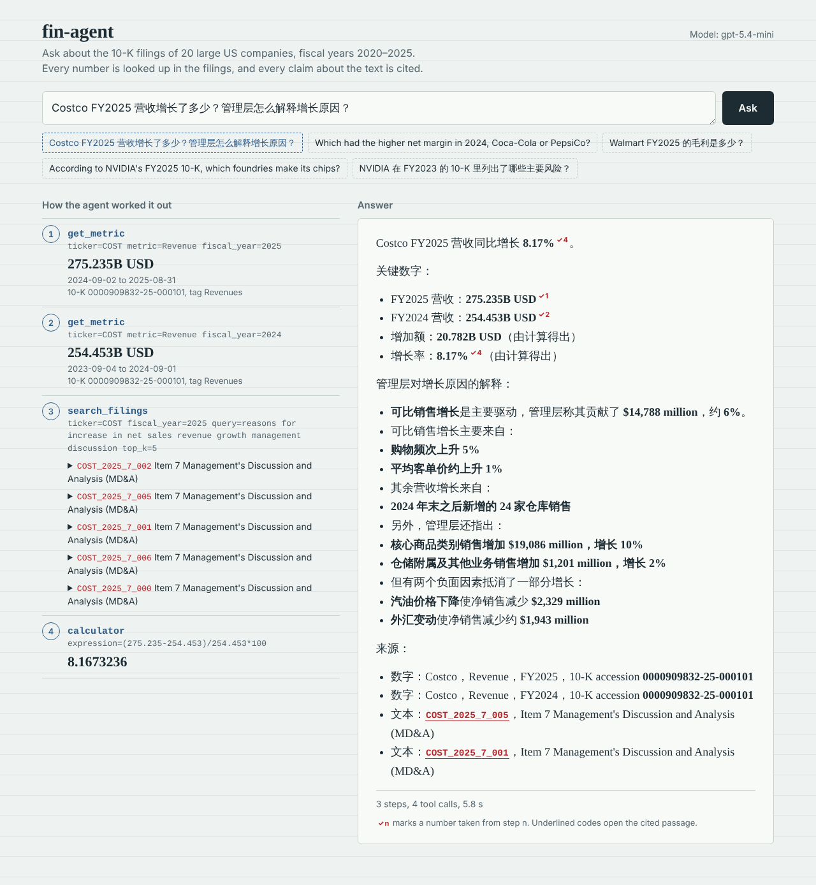
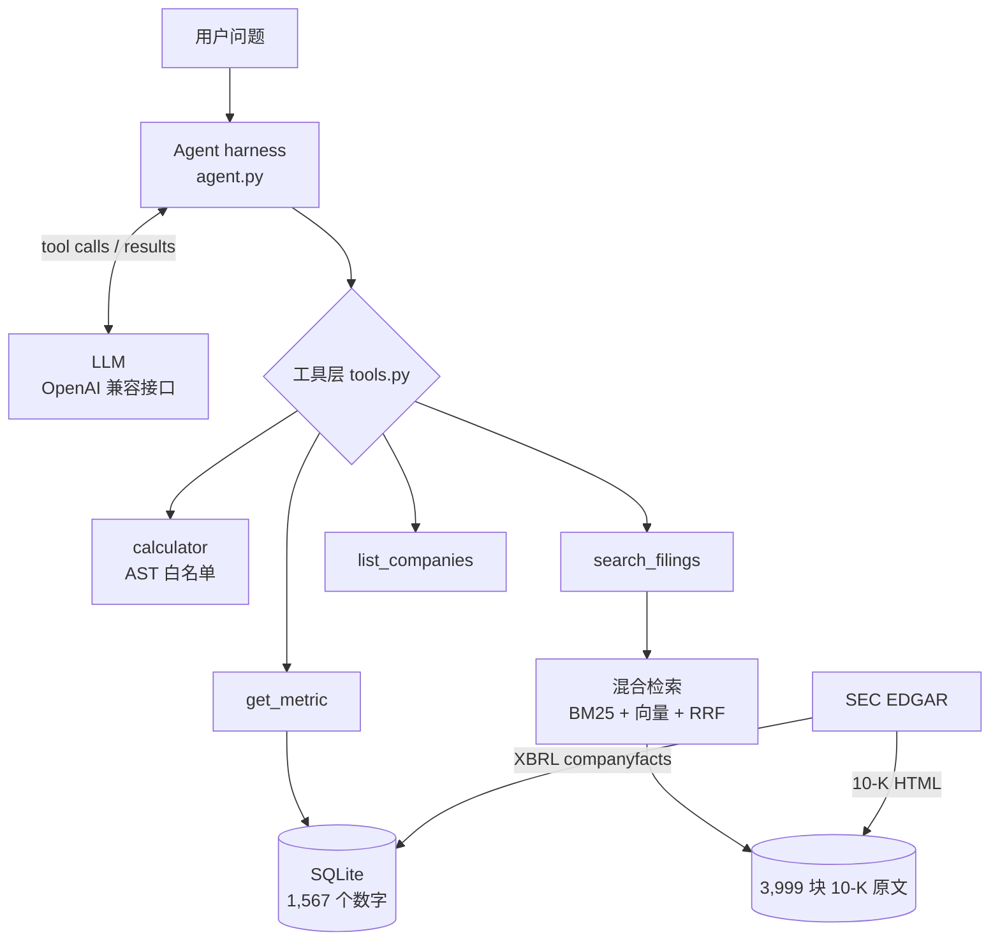

# fin-agent：基于 SEC 财报的金融问答 Agent

一个能回答美股上市公司财务问题的 AI Agent。它会**自己决定**每一步该查数据库、做计算，还是读财报原文，最后给出**带出处**的答案。

- **手写 Agent harness**：tool-calling 循环、错误回传、步数上限、trace 日志、财年一致性 guardrail，不依赖 LangChain 等框架
- **结构化数据**：SEC XBRL → SQLite，20 家公司 × 14 项指标 × FY2020–2025，共 1,567 个数字
- **混合检索 RAG**：手写 BM25 + 向量检索，用 RRF 融合；40 份 10-K 切分为 3,999 块
- **评测**：自建 60 题评测集 + LLM-as-judge，3 次运行平均准确率 **99.4%**，并做了 ablation 对比实验
- **网页**：FastAPI 后端 + 原生 HTML/JS 前端，逐步流式显示推理过程；答案里每个查出来的数字都带勾稽标记，指向产生它的那一步



*左边是 Agent 的推理过程，右边是答案。带红色 ✓ 的数字来自对应编号的工具调用，带下划线的编号可以点开查看引用的原文。*

---

## 示例

> **问：** Costco FY2025 营收增长了多少？管理层怎么解释增长原因？

Agent 实际的执行过程（`python scripts/ask.py "..."`）：

```
[step 1] get_metric(COST, Revenue, 2025)        → 275.235B USD
[step 2] get_metric(COST, Revenue, 2024)        → 254.453B USD
[step 3] calculator((275.235-254.453)/254.453*100) → 8.17
[step 4] search_filings("why revenue increased ...", ticker=COST, fiscal_year=2025)
         → COST_2025_7_005 (Item 7 MD&A) ...
```

> **答：** Costco FY2025 营收同比增长 **8.17%**（275.235B vs 254.453B USD）。管理层解释：主要来自可比销售增长（购物频次 +5%，客单价约 +1%），其余来自 24 家新开仓库；汽油价格下降和汇率变化拖累了增长。
> 来源：COST Revenue FY2025 / FY2024，10-K accession 0000909832-25-000101；COST_2025_7_005（Item 7 MD&A）

这道题需要同时用到两种数据：数字从数据库里查，原因从财报原文里找。Agent 自己把问题拆成了这两部分。

---

## 架构



**Harness 循环**（`src/finagent/agent.py`）：把对话历史发给模型 → 模型要调用工具就执行，并把结果写回历史 → 不调用工具时，它的回复就是最终答案。最多 8 步；走满 8 步时，不再提供工具，强制模型根据已有信息作答。

---

## 关键设计决策

| 决策 | 为什么 | 代价 / 放弃了什么 |
|---|---|---|
| **手写 harness，不用 LangChain** | 每一行都能讲清楚、能调试；规模小（单 Agent、4 个工具），框架带来的好处有限 | 重试、流式输出等功能需要自己实现 |
| **SQLite 长表**（一行 = 公司 × 指标 × 年） | `get_metric` 可以完全用参数化 SQL，不用拼接列名，避免 SQL injection；每个数字都带自己的出处 | 跨指标查看需要 pivot |
| **按 `end` 日期定财年，不用 XBRL 的 `fy` 字段** | `fy` 是*报告*的年份：一份 10-K 会同时列出三年的数字，`fy` 都一样 | 需要自己过滤季度数据（只保留 350–380 天的期间） |
| **营收标签按优先级回退，`Revenues` 优先** | 实测发现 Walmart 用 `RevenueFromContract...` 会漏掉会员费，少 0.85% | 候选顺序需要用真实数据验证 |
| **缺失的指标不自己算、不存** | 库里的每个数字都有原始出处；需要推导时由 Agent 计算并说明 | Agent 要多走几步 |
| **calculator 用 AST 白名单，不用 `eval`** | `eval` 能执行任意代码 | 只支持 `+ - * / **` 和括号 |
| **工具出错时返回提示，而不是抛异常** | 模型看到提示后能自我修正（例如把指标名拼对） | — |
| **数据库只读打开**（`mode=ro`） | 纵深防御：白名单、参数化 SQL、只读，三层互相独立 | — |
| **混合检索 + RRF**（k=60） | BM25 擅长专有名词，向量检索擅长同义改写；RRF 只看名次，不需要对齐两种分数的尺度 | 每次检索多一次 embedding 调用 |
| **不用向量数据库** | 只有 3,999 个向量，而且会先按公司和年份筛选，NumPy 几毫秒就能算完 | 数据量到几十万块时需要换 FAISS 等 |
| **财年 guardrail（代码级）** | 评测发现模型会把 "FY2023" 悄悄换成 FY2024 来回答，prompt 规则管不住 | 要专门设计、测试误报（最终 0 误报） |

---

## 评测

评测集：`evals/questions.jsonl`（40 题）+ `evals/hard.jsonl`（20 题难题）。

| 类型 | 题数 | 考什么 |
|---|---|---|
| lookup | 15 | 查对一个数字 |
| calc | 15 | 多个数字 + 计算（增长率、利润率、CAGR、推导缺失的毛利） |
| text | 10 | 检索并总结 10-K 原文 |
| hard_num | 10 | 隐含年份（"最近一个财年"）、非日历财年、多步查询（10 次查询）、数字只在原文里 |
| hard_text | 5 | 换一种说法提问，问题里没有原文的关键词 |
| unanswerable | 5 | 数据中没有的公司 / 年份。正确行为是明确说明"不可用" |

**评分方法**
- **数字题**：从答案中提取"数字 + 单位"（B / 亿 / million / % / 个百分点），相对误差 < 1% 算对；比较题还要求说对公司。标准答案是写成表达式、从数据库算出来的，不是手填的数字。
- **原文题**：① 检索命中：检索结果里是否包含预先确认过的关键句；② 引用检查：答案里的 chunk_id 是否真的出现在检索结果里；③ LLM-as-judge（gpt-5.4）按要点打 1–5 分，≥ 4 分算对。
- **不可回答题**：裁判判断答案有没有明确说明"数据不可用"，并且没有拿替代数据冒充答案。

### 结果（Agent：gpt-5.4-mini，每个配置跑 3 次取平均）

| 类型 | 正确率 |
|---|---|
| lookup / calc / text / hard_num / unanswerable | 100% |
| hard_text | 93.3% |
| **总计（60 题 × 3 次）** | **99.4%**（179 / 180） |

原文题：检索命中 97.8%，**编造引用 0 次**。

### Ablation：calculator

| 配置 | 计算类题目（25 题） | 平均步数 |
|---|---|---|
| 完整系统 | **100%** | 2.61 |
| 去掉 calculator，**保留**"必须使用 calculator"的规则 | 65.3% | 3.99 |
| 去掉 calculator，规则改为"自己计算"（公平对比） | 97.3% | 2.21 |

第二行**不是**有效的对比：大多数失败是模型因为"规则要求用 calculator，但工具不存在"而拒绝计算，并不是算错了。真实的差距看第三行：只有 2.7 个百分点，全部集中在 CAGR（需要开 4 次方根）这道题上。结论：对这个模型来说，简单的加减乘除不用 calculator 也能算对，calculator 的价值在于复杂运算和结果的稳定性。小模型的情况未验证。

### Ablation：检索方式

端到端评测里，三种检索方式的差距在随机误差以内（95.6%–97.8%）。为了单独比较检索，把 Agent 在评测中实际写出的 43 条查询拿出来重放（`evals/retrieval_ablation.py`，结果是确定性的）：

| 条件 | k | BM25 | 向量 | 混合 |
|---|---|---|---|---|
| 按公司 + 年份筛选（实际用法） | 1 | 70% | 63% | **72%** |
| | 3 | 88% | **93%** | 91% |
| | 5 | **98%** | 95% | **98%** |
| 不筛选（3,999 块） | 1 | 58% | 56% | **63%** |
| | 3 | 72% | 72% | **79%** |
| | 5 | 72% | **84%** | **84%** |

*hit@k：前 k 个结果中，至少有一块包含关键句。*

- **筛选的作用最大**：混合检索 hit@3，筛选后 91%，不筛选 79%。
- 条件越严格，混合检索的优势越明显：不筛选时 hit@3 比两种单一方法都高 7 个百分点。

### 评测过程中发现并修复的问题

| 问题 | 原因 | 修复 |
|---|---|---|
| 把 169.232B 写成"169.232 亿"（错了 10 倍） | 模型在写答案时自己换算单位 | 规则：原样照抄工具返回的 `display` 字段 |
| "最近一个财年"查成了 FY2024 | 模型不知道数据覆盖哪些年份 | 数据范围从代码常量自动生成，写进 system prompt |
| 用总营收冒充"会员费收入" | 指标列表里没有会员费，模型用了相似的指标 | 规则：不在指标列表里的内容，去原文里找 |
| "FY2023 的风险"被悄悄换成了 FY2024 | 模型把 FY2023 理解成了"大部分在 2023 年的财年" | prompt 规则无效 → 改成 **harness 级 guardrail** |
| 一半答案没写 chunk_id | system prompt 里两条规则互相矛盾 | 合并成一条 |
| 3 处评分误判 | 评分程序不认"个百分点"、不认四舍五入；有一道题的答案会随时间变化 | 修正评分规则；题目写明年份 |

---

## 快速开始

```bash
conda create -n fin-agent python=3.11 -y && conda activate fin-agent
pip install -r requirements.txt
cp .env.example .env          # 填入 LLM_API_KEY / LLM_BASE_URL / LLM_MODEL，以及 SEC_USER_AGENT（姓名 + 邮箱）
python scripts/check_setup.py # 环境自检

# 构建数据（下载结果会缓存在 data/raw/，重复运行只需几秒）
python scripts/build_db.py        # SEC XBRL → data/finance.db（约 1 分钟）
python scripts/build_filings.py   # 下载 10-K 原文并按 Item 切分（约 2 分钟）
python scripts/build_index.py     # 切块 + embedding（约 1.5 分钟，OpenAI 费用约 0.04 美元）

# 提问（命令行）
python scripts/ask.py "Apple 2024 财年营收比 2023 年增长了多少？"

# 提问（网页）：只监听本机 127.0.0.1，然后在浏览器打开 http://127.0.0.1:8000
python web/app.py

# 评测
python evals/run_eval.py --set all --name my_run          # 60 题，约 1 分钟
python evals/run_eval.py --set all --no-calculator-fair   # ablation：去掉 calculator
python evals/run_eval.py --set all --search-mode bm25     # ablation：只用 BM25
python evals/summarize.py my_run                          # 汇总多次运行的结果
python evals/retrieval_ablation.py my_run                 # 检索 ablation
```

模型通过 OpenAI 兼容接口调用，换模型只需修改 `.env`。上面的评测结果使用 `gpt-5.4-mini`（Agent）、`gpt-5.4`（裁判）和 `text-embedding-3-small`。`.env.example` 里预留了本地 Ollama 的配置，但**这条路径还没有跑过评测**。

---

## 项目结构

```
fin-agent/
├── src/finagent/
│   ├── agent.py        # harness：循环、system prompt、财年 guardrail、trace
│   ├── tools.py        # 4 个工具 + JSON schema + run_tool 统一入口
│   ├── metrics.py      # 14 项指标的 XBRL 候选标签、20 家公司、年份范围
│   ├── sec.py          # SEC 下载 + 本地缓存
│   ├── ingest.py       # 从 XBRL 记录中为每个（指标, 财年）挑出唯一正确的数字
│   ├── db.py           # SQLite 表结构
│   ├── filings.py      # 10-K HTML → 纯文本 → 按 Item 切分
│   ├── chunking.py     # 按段落装箱切块（约 500 tokens，重叠 40 词）
│   ├── bm25.py         # 手写 BM25
│   ├── rag.py          # 向量检索 + RRF 混合检索
│   └── config.py       # 从 .env 读取配置
├── web/
│   ├── app.py          # FastAPI：/api/ask（一次性返回）、/api/ask/stream（SSE 逐步推送）、限流
│   └── static/index.html  # 单页前端：推理步骤、勾稽标记、引用弹窗（无外部依赖）
├── scripts/            # 构建数据、提问、环境自检
└── evals/              # 评测集、评分、汇总、检索 ablation
```

---

## 局限与下一步

- **评测规模小**：60 题，每题约 1.7 个百分点；题目由作者出，可能不自觉地避开了系统的弱点。
- **模型**：所有结果只针对 gpt-5.4-mini。下一步：换成本地 Qwen3（Ollama）重跑评测，对比大小模型。
- **原文覆盖**：只索引了 FY2024–2025 的 Item 1 / 1A / 7。Intel、IBM、McDonald's、Chevron 的 10-K 结构不标准，按整篇存储（引用时没有 Item 信息）；IBM 的 MD&A 在年报附件里，没有收录。
- **单位**：MD&A 原文里的金额通常以百万美元为单位，切块后单位说明可能不在同一块里，答案可能丢失单位。
- **网页**：只在本机运行，没有部署。部署到公网需要先加身份验证和按用户限流，否则任何人都能消耗 API 额度。浏览器断开时，正在运行的那道题不会被取消（harness 没有中途取消的机制），最多跑完 8 步。
- **计划中**：MCP server 封装工具层。
